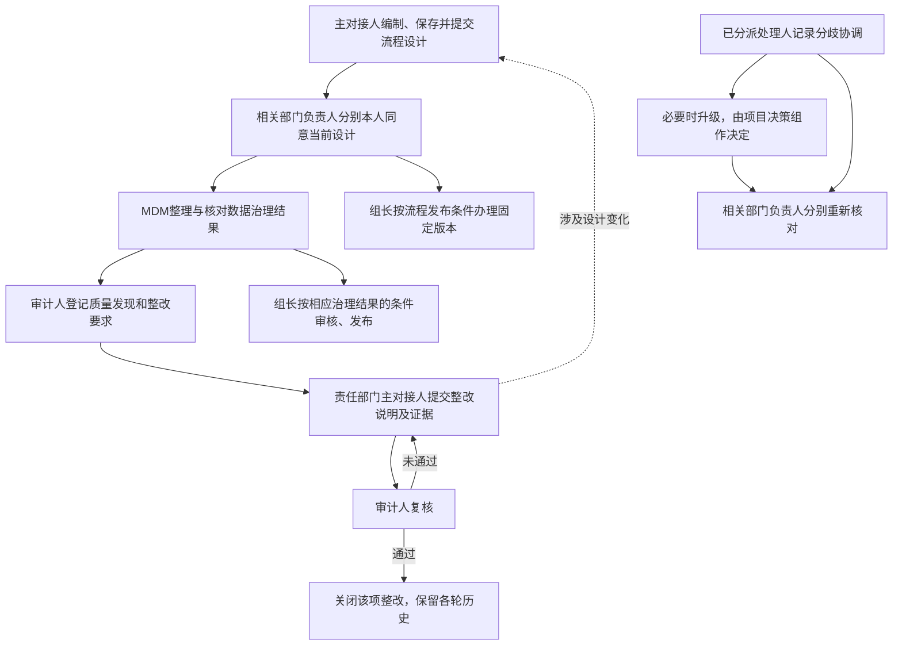

# MDM平台角色分工与办理交接

## 确认依据与适用范围

2026-11-05，用户在本轮对话明确确认：“同意这套分工，继续推进MDM平台上线准备，按矩阵检查各角色的办理入口和交接闭环。”本说明据此记录当前确认的RACI、CURD及入口核对标准。前一轮待审阅原稿保留于[历史提案](../../artifacts/3000-quality-audit-readiness-20261105-01/mdm-raci-curd-review.md)，不再作为待决定事项重复征询。

确认包含原稿的执行、负责、征询及知悉分工。C/I说明协作关系，不自动授予读取、修改、确认、发布或删除权限，也不自动通知相关人员。实际人员任命、授权、部门范围及事项分派以MDM平台当前有效记录为准；本轮未给真实员工授权。

2026-11-05已按用户授权将本轮角色交接实现部署至MDM平台并开启质量审计，实际目标、版本及恢复证据见[DOCKER.md](DOCKER.md)。业务分工已经确认，软件部署及技术验证不代替业务验收。

## 治理链条

审计以相关部门负责人对当前准确设计的本人同意为前提；设计变化后重新确认。审计结论不代替设计同意，也不自动形成流程或数据地图发布。分歧协调、重大决定和部门重新核对分别留痕，不能用一个动作代替另一主体的决定。

## RACI

R表示执行，A表示对该项结果负责，C表示征询或协作，I表示知悉，—表示不承担该项职责。治理经办的R仅在有明确分派时成立。组长可以亲自办理其已有权限范围内的治理工作，不代替部门确认业务事实。

| 治理活动 | 主对接人 | 部门负责人 | 治理经办 | MDM组长 | 质量审计人 | 冲突处理人 | 项目决策组 |
|---|:---:|:---:|:---:|:---:|:---:|:---:|:---:|
| 流程设计与来源材料编制、提交 | R | A | C | I | — | — | — |
| 本部门事实及当前流程设计同意 | C | R/A | C | I | I | — | — |
| 数据对象、字段、术语与使用规则的治理整理 | C | C | R | A | C | — | — |
| 数据质量检查、发现登记与整改要求 | C | C | C | I | R/A | — | — |
| 本部门整改组织、说明及证据提交 | R | A | C | I | C | — | — |
| 涉及流程设计变更后的再次同意 | C | R/A | C | I | I | — | — |
| 数据质量整改复核、退回或关闭 | C | I | C | I | R/A | — | — |
| 一般分歧协调 | C | A¹ | C | I | C | R | — |
| 重大争议作出决定 | I | C | — | I | C | C | R/A |
| 决定后的本部门事实重新核对 | C | R/A | C | I | I | C | I |
| 流程固定版本发布 | I | C | C | R/A | I | — | I |
| 数据地图、术语等治理版本发布 | I | C | C | R/A | C | — | I |

¹ 各受影响部门负责人分别对本部门事实和决定负责，冲突处理人对协调材料和过程负责。重大争议由有权且实际承办的处理人或组长准备材料，决策组作决定。

质量审计人的A限审计及复核结论，部门负责人仍对本部门事实与整改结果负责。组长对相应治理审核及发布条件负责，不取得部门业务认定权。

| 保障活动 | 执行与操作责任 | 边界 |
|---|---|---|
| 组织、人员目录维护 | 行政人事信息维护员 | 保存直接生效并留痕；不因此取得账号授权权 |
| 账号、角色授权及访问审计 | 系统管理员 | 对维护操作负责；治理材料只读，不代审核、整改或发布 |

## CURD

C创建、U修改或追加、R查阅、D物理删除。确认、复核和发布是单独业务动作，不能仅凭U权限执行。

| 记录对象 | C创建 | U修改或追加 | R查阅范围 | D物理删除及决定边界 |
|---|---|---|---|---|
| 流程编制草稿 | 主对接人或已明确的编制人员 | 有效编制者修改未提交内容，提交后续修形成新修订 | 按部门及事项资格 | 不新增删除权；主对接人本人提交，不继承上传文件审核状态 |
| 已提交设计与部门确认 | 主对接人提交修订；负责人本人作决定 | 修订、退回或新决定另行留痕，不覆盖原记录 | 按当前或绑定历史修订的读取资格 | 保留正文和意见；各部门只确认本部门一侧 |
| MDM工作包治理结论 | 组长或明确分派经办人 | 按未完成包的可办状态修订并保留依据 | MDM按资格；业务部门只读定向事实所需上下文 | 不新增删除权；完成包不直接改写 |
| 定向事实问题与答复 | MDM提问；目标部门有权人员答复 | 对原问题补充或受控续记 | 按问题范围 | 保留历史；部门答复不自动成为治理结论 |
| 质量发现及整改要求 | 审计人在设计已获本人同意后登记 | 审计人明确更新同档已确认设计依据及要求，保留原记录 | 审计人、组长、责任部门；管理员只读 | 保留审计历史；不得更正源数据或发布版本 |
| 整改说明及证据 | 责任部门主对接人 | 退回后重交，旧轮次保留 | 同上 | 保留已提交证据；设计变化先重新同意 |
| 质量复核结论 | 质量审计人 | 后续复核另记，不能覆盖旧结论 | 同上 | 保留历史；合格关闭本事项，不代表版本已发布 |
| 分歧协调、重大决定及部门重核 | 已分派处理人、决策组、当前负责人分别记录本人动作 | 后续方案、决定和重核分别追加 | 按分派、升级及部门参与资格 | 保留历史；协调或决定不自动代替部门重新核对 |
| 已发布流程、地图及术语版本 | 有发布权限的组长按各自发布动作形成 | 后续修改形成新版本 | 按对应版本与范围 | 保留固定版本及追溯记录 |

## 各角色从哪里接手、交给谁、到哪里核对结果

优先从“我的工作台”进入准确事项；没有本人待办时，角色说明提供的是职责入口，不计入待办数量。可见入口不代表具备全部动作权限，实际办理仍核对来源、状态、分派、部门及当前授权。

| 角色 | 办理入口与接手条件 | 本人办理及交接 | 结果查阅 |
|---|---|---|---|
| 行政人事信息维护员 | 组织架构、花名册；具备目录维护权限 | 维护已明确的组织人员资料及原因，保存后直接生效；需要开户时交管理员核对同一员工 | 目录导入与维护记录中的前后内容、操作人和原因 |
| 系统管理员 | 账号与授权办理；已有员工资料 | 开通、授权、启停账号，随后交本人按实际角色办理；治理只读，叠加业务角色也不能写 | 同员工账号行、授权记录及访问审计 |
| 部门主对接人 | 工作台、流程编制与草稿、定向事实或质量整改事项；本部门有效资格 | 编制提交交负责人；按退回意见续修；整改说明和证据交质量审计人复核 | 原案例本次核对、正式流转、原事实答复或原质量发现历史 |
| 部门负责人 | 工作台、流程预览与核对、流程正式流转，以及本部门分歧重核事项 | 已登记且有效授权者本人核对本部门一侧；确认或退回主对接人；设计或分歧处理后重新核对 | 原事项决定、退回依据及历史；本部门质量整改可查阅，质量结论由审计人负责 |
| MDM治理经办人 | 工作台或收到的待办；组长对案例或工作包的有效明确分派 | 在绑定来源下登记治理材料及依据，交组长审核；不代确认、不发布 | 原案例责任与历史、原工作包已记录治理结论 |
| MDM组长 | 工作台、责任与历史、正式数据治理工作包、相应发布工作区 | 明确分派，核对经办结果，缺事实时定向提问，按各自条件审核发布；跟踪质量整改与分歧 | 原经办记录、工作包结果、发布记录及原质量发现历史 |
| 数据质量审计人 | 工作台、数据质量；当前设计已有相关部门负责人本人同意 | 登记发现及要求交责任部门；复核证据，合格关闭、不合格退回；设计变化先重新确认并明确更新依据 | 同一质量发现中的各轮证据、复核结论及历史 |
| 数据冲突处理人 | 工作台或原冲突；本人有效分派 | 核对立场与依据，记录方案交相关部门重核；重大事项补齐材料后升级交决策组 | 原流程争议、承接分歧或普通冲突历史；协调不代替部门确认 |
| 项目决策组 | 工作台或原争议；已经升级且具备必要证据 | 记录重大决定及依据，交相关部门分别重新核对；不代日常修改、发布或账号维护 | 原争议决定及后续部门重核记录 |

上述表格是当前已确认的目标行为。上线准备的技术证据见[角色交接准备报告](../../artifacts/3000-role-handoff-readiness-20261105-01/report.md)；九角色代表办理链、四维工作评分及5项修复的发现过程见[角色体验报告](../../artifacts/3000-postlaunch-role-experience-20261105-01/report.md)。5项修复已于2026-11-05部署MDM平台，正式保全和上线后复验见[部署报告](../../artifacts/3000-role-experience-deploy-20261105-01/report.md)。未覆盖分支及真实使用者验收分别列明，不得仅凭说明宣布全部闭环已实现或已验收。
