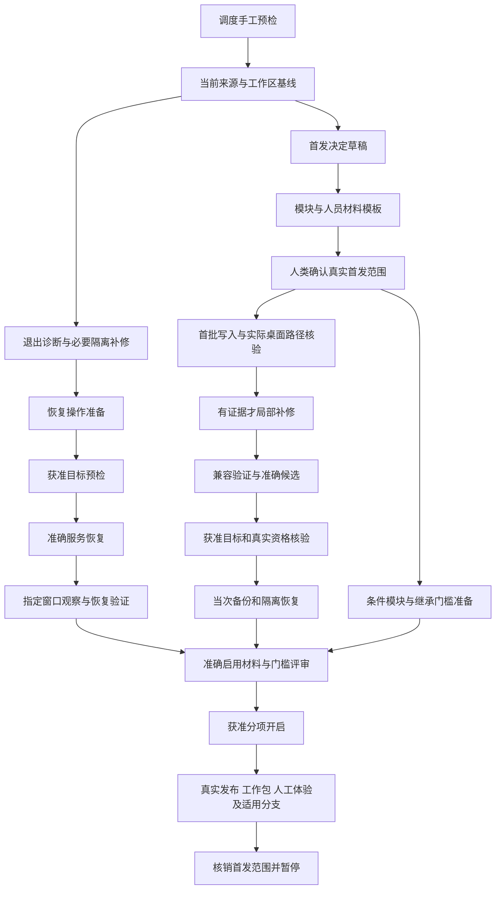

# 3000 最小上线审阅与定时新会话逐条推进计划

2026-10-08接续：用户已明确先做3000架构整改及验证，业务上线推进暂停。节奏改为短步骤连续执行、阶段完成后接续新会话，每小时仅作中断恢复检查；本页原频率、运行现状及授权是编制时点记录。以[13架构整改与连续推进计划](13-3000架构整改与连续推进计划.md)及本轮实际结果为准，现有自动任务仍暂停。

日期：2026-10-08。状态：审阅与详细计划已形成，自动执行尚未激活。适用对象：`E:\CA001\Infomat` 本地 3000，继续原 `p00-20260916-120151` 批次及 **P25**。本文件细化 [10原计划](10-3000最小上线与增量完善计划.md)，任务定义及保存提示词见 [12任务卡](12-定时推进任务卡与会话提示词.md)。

本次用户明确要求“审阅并详细制定计划”，拟采用定时任务每次新建会话逐条推进；随后确认频率为“全天每小时推进一条（北京时间）”。这一确认固定调度方式和频率；本轮仍是计划工作，不自行解释为已经激活自动实施、连接数据库、恢复服务或开放业务。本次没有这些运行动作。

## 1. 审阅结论

原计划的方向可以保留：复用原生 V8 及现有能力，先定位运行问题，确定真实首批范围与资格，补首批有证据的失败，绑定准确候选和当次恢复条件，再获准启用及真实验收。没有证据支持把全面重构作为上线前提。

原计划尚不足以直接作为新会话自动任务的保存提示词：T1—T6 粒度较大，缺少跨会话唯一台账、互斥和结果提交规则，真实业务等待项与自动可执行项混在一起。另有一处实质恢复风险：历史 02 副本的固定来源消费边界仍仅 V7，不能直接用作产生 V8 业务记录后的回退候选。本计划补足这些内容，但不替人类确认首批业务范围、人员资格或验收。

### 本轮取得的当前证据

| 对象 | 本轮核验结果 | 证据边界 |
|---|---|---|
| 当前工作区 | 分支 `codex/single-process-authoring-skill`；HEAD `e96a220ed6c2308fc7a3d9a253c6301672109ab1`；起始 87 个已跟踪修改、314 个展开未跟踪文件；3000 有 83 个已跟踪修改；暂存区为空 | 是本轮计划编写前的 Git 计数，不是阶段完成量；之后必须重新核对 |
| 原 10 计划 | 34,628 字节；原始 SHA-256 `2b5d40f95e671a94eaa50c3b7137f59a6972e09797835bc0df2fea1e81571f5d` | 作为审阅输入保留，末尾增加接续链接；原内容字节保持 |
| 最新 V8 候选 ZIP | 本轮重算为 59,045,502 字节，SHA-256 `26239b520bef7b70833164e5952ee86fd5015bf868c5dca7ed5f6f3933438d10` | 只核对 ZIP 本身；本轮没有重做包内全部文件或业务链测试 |
| 最新累计记录 | execution.md 开头为 2026-10-08 V8 准备复核；合同最新第 114 节为原生 V8 主线 | 是技术实施和历史运行记录，不能作为本次新增正式动作授权 |
| 运行副本与来源 | 最近记录指向 `runtime/3000-20261008-03/payload/apps/mdm-platform`；来源摘要 `4a17f6dabe8cf468cbe821b7b6ce02582ca33a301fb4ede592c3c636838c2684` | 本轮未测进程、端口、health、ready、数据库、实际开关或账号 |
| 历史 02 副本 | `server/processNativeFormats.js` 不存在；其 `server/v7FixedSource.js` 的正式版本读取仍要求 `schema_version==='process-governance-v7'` | 足以说明不能默认将它作为完整 V8 业务回退；并非对 02 全部代码的完整复验 |
| 既有自动任务 | `infomat-3000`，`kind=heartbeat`，`status=PAUSED`，每小时一次，目标原会话 `01a10d74-1c97-7460-b817-04adb3a75167` | 已只读核对配置并调用工具查看；未更新、恢复、删除或创建自动任务 |
| 新任务所属项目 | 已核对 Infomat 项目：`local-f36a4f0d90428e698f5dcd1023495a7e`，本地路径 `E:\CA001\Infomat` | 项目标识仅供激活时再次核对，不用于创建阶段会话 |

原计划记载 11:56 及委派提供 12:23 的失败。最新准备复核报告确有 11:56 无监听、ECONNREFUSED；本轮没有独立核验 12:23，更没有把这些观察写成此刻状态。P25 仍未取得首批业务验收完成的证据。

### 必须处理的审阅事项

| 编号 | 判断与影响 | 本计划处理 |
|---|---|---|
| R01 | T1—T6 一卡含多类副作用，新会话容易把诊断、恢复、开户及启用连做 | 拆为 26 张主线执行卡、6 张条件卡；另设一张手工调度预检卡。每轮只认领一张卡或一个具体补丁 |
| R02 | 状态文件仍写 running 不证明真实进程；退出原因未知 | A03 对应准确副本、日志、父进程和时序；原因缺证据就列缺口，不假定守护退出或数据库错误 |
| R03 | `runtime-service.cjs check` 也使用受保护凭据并连接数据库，不属于纯文件诊断 | A03 禁止运行该入口；实际目标预检和维护检查放入有准确授权的 A07/A18 |
| R04 | 02 固定来源只接受 V7；业务开放后直接回退可能拒绝 V8 下游办理 | A17 验证 V8 代码回退候选；优先保留当前 V8 固定基线作为后续补丁的回退依据，不以旧 02 默认兜底 |
| R05 | 一张卡写“完成”可能只完成准备，掩盖业务待办 | 准备、运行和真实验收分别分卡；每次报告采用已实现／已准备／已开启／已验收的实际证据层次 |
| R06 | G0 未收口，主链及 OFF 历史前提可能被无意删去 | A12 固定当前决定；A28 为每项确认适用性及门槛位置；A32 只处理获准后续预演，不自行后移原前提 |
| R07 | 实际人员与办公室关系未核验，不能用 admin 或岗位推断替代 | A11 准备清单，A19 核验真实资格；真实办理 A23/A24/A31 由对应人类主体执行 |
| R08 | 已有导入请求 ID、原快照、默认工作台和多个选择器，不应重复开发 | A13/A14 对实际首批路径逐项核对；A15 只处理可复现缺陷 |
| R09 | 旧 SQL 恢复点不能覆盖未来合法写入、密码、会话与权限 | A20 取得当次受保护恢复点并隔离验证；区分代码回退、停写、业务补偿和数据恢复 |
| R10 | 原 heartbeat 保存的候选仍停在合同 111，不能直接恢复后认作 V8 基线 | 激活时替换为本计划入口及共享台账，保留旧历史；禁止旧调度与新调度同时活跃 |
| R11 | 按定时频率机械走编号会造成重复、重叠和业务误验收 | 用依赖、授权、到期时间和证据选择任务；等待项不阻止独立任务；结果不明先核对，不盲重放 |
| R12 | 30 多张任务卡不等于 30 多小时或固定上线日期 | 每小时只是触发频率。补丁数量、观察时间、人类办理与授权窗口确定后再估投入和日期 |

## 2. 目标、范围与决定边界

首发终点暂沿用历史记录中的“发布流程正式版本，并完成该版本的治理工作包”，在 A12 由用户核对继续适用。不能将登录或页面可见当作首批业务上线；也不能把单流程首发写成全公司上线。

保留 Express/MySQL、React/Vite、固定角色及管理员治理只读；主线为原生 `process-governance-v8`，受支持 V7 的正文、摘要、审核、稳定 ID、旧规则和兼容名称不转换。3001 继续独立、无状态、单流程，用户主动下载未审核 JSON 后手动上传 3000，退回在 3001 修订后上传原案例，不共享数据库或自动互写。

默认任务边界是运行、首批路径、首批候选及真实启用验收的准备和必要补修。完整运营看板、微服务、全体旧页替换、正式主数据认定与数据地图发布、真实模型、自动派单／通知、外部系统实际写入和全公司扩围不因接受本计划而自动纳入。

需要人类收口的业务决定仍是三组：

1. **首发范围与原材料**：哪些真实流程和材料版本；正式版本＋工作包终点是否继续；主链、三类待办和 OFF-01—OFF-10 逐项在何时满足，哪些经明确决定调整。
2. **主体及验收**：真实上传／编制、各部门事实核对、正式审核发布、MDM 工作包、必要办公室主体和有权验收主体；由用户指定原始人员及材料来源。
3. **目标及维护**：本机受控试用或局域网持续使用；实际地址、人数／并发、维护与恢复执行者、允许中断和观察窗口，以及验收后保持运行或关闭。

本轮不提前让用户为每张技术卡重复审批。真正缺少的范围或授权，只针对准确对象和动作合并提交一次；已有同一准确范围的人类授权经核对后继续有效。

## 3. 定时任务采用什么方式

采用原生**独立项目定时任务**，工具类型为 `cron`，每次运行由调度器新建一个会话，直接处理一条任务；无需在定时会话里再调用 create_thread。保存提示词见 12 文件。

用户确认的节奏为 **Asia/Shanghai，北京时间，全天每小时触发一次**。激活时在工具中设置原生周期，核对界面显示和下一次运行；不在计划中手写系统 cron、不另外运行 PowerShell 后台计时器，也不把原 heartbeat 包装为新会话循环。

OpenAI 当前官方说明确认：独立定时任务每轮创建新会话，项目任务可选择本地项目目录或工作树；需要本地文件时电脑须开机且应用运行。任务使用默认权限设置，不意味着新增业务授权。本方案由此选择本地目录，以保留累计未提交成果。[官方定时任务说明](https://developers.openai.com/codex/app/automations)

### 项目、模型和既有任务

- 项目固定为已核对的 Infomat 本地项目，激活前复核项目标识及路径。使用 `executionEnvironment=local`，不从 HEAD 自动建立新 worktree；如果未来需要隔离副本，必须带完整累计来源清单并单独明确交接。
- 模型和推理保持用户当前默认选择。当前 cron 工具创建参数需要 model、reasoningEffort；激活前取得实际默认值，不能沿用历史模型名或自行切换。无法核实则保持待配置，不填造参数。
- 先尝试通过自动任务工具更新原 `infomat-3000` 为独立项目任务；**本轮未确认工具是否支持跨类型更新**。若支持，复用原 ID，保留历史及通知设置。
- 若工具不支持跨类型更新，原 heartbeat 继续暂停，建立唯一替换 cron 并记录原 ID、新 ID 及替换原因；不删除原会话或执行记录。这是用户明确要求新会话方式的替换，不是创建并行调度。
- 激活前和第一次运行后检查实际任务元数据，确认没有第二个活跃的同范围自动任务。原先自动提示词中的“完全访问”记载不单独证明新的业务授权；不修改权限配置绕过工具要求。
- 本轮只编制计划与可审查材料，既有任务保持暂停。后续用户明确按计划启动时，先完成 A00 手工预检，再通过原生自动任务工具配置并激活；不使用原始调度指令或直接修改 automation.toml。

## 4. 任务次序与可独立推进的部分

A00 是激活前的手工验证。A01—A26 组成主线，A27—A32 是条件能力的准备及验收；这些只是 P25 内任务键。优先级是运行阻碍、独立前置准备、首批真实范围、必要补修、候选／目标／恢复、启用、真实验收。

缺少业务材料时，A03—A11 的适用诊断和准备可以继续。缺少实际运行或数据库授权时，停在对应 A07/A08，不阻止本地模块、人员模板和安全准备。没有具体首批缺陷时 A15 依据核验记录跳过；已实现能力不重复开发。分析、办公室及继承预演只有经明确确认不适用，才可不阻止对应门槛。

A27 和 A29 只形成启用准备，不等待尚未开启的真实办理；实际运行和业务办理在 A30/A31，因此不形成“先验收才启用”的循环。A28 必须先明确每个 OFF 项的门槛位置，不能自行把原本启用前要求移到 A32。若预演确需功能先开放，用户要明确那一阶段的开放边界；A22 仅按该准确授权开放。A23 正式发布及 A26 首发关闭仍受对应实际门槛限制。

任务简表如下；每卡的具体动作、输出、完成标准、停止及恢复条件见 12 文件。

| 任务键 | 任务 | 原计划归属 | 固定前置任务键 |
|---|---|---|---|
| P25-A00 | 验证新会话调度、台账和互斥入口 | 调度前置 | — |
| P25-A01 | 固定当前源码、候选和工作区基线 | T1 | A00 |
| P25-A02 | 形成首发范围草稿与决定清单 | T1 | A01 |
| P25-A03 | 只读定位准确 3000 的退出原因 | T1 | A01 |
| P25-A04 | 隔离复现已定位的运行故障并确定补丁 | T2 | A03 |
| P25-A05 | 实施并验证一个运行补丁 | T2 | A04 |
| P25-A06 | 准备准确恢复动作及运行授权材料 | T2 | A03、A05 |
| P25-A07 | 执行获准的运行目标预检 | T2 | A06 |
| P25-A08 | 恢复获准的准确 3000 并取得首轮运行证据 | T2 | A07 |
| P25-A09 | 完成批准窗口的运行观察与恢复验证 | T2 | A08 |
| P25-A10 | 准备首批模块和目标检查清单 | T3 | A01、A02 |
| P25-A11 | 准备首批人员、材料和验收记录模板 | T3 | A02 |
| P25-A12 | 确认首发范围并核验指定材料与主体 | T3 | A02、A10、A11 |
| P25-A13 | 核验首批写入的权限、事务和并发保护 | T4 | A12 |
| P25-A14 | 验证首批入口、选择器及详情的实际桌面路径 | T4 | A12、A13 |
| P25-A15 | 逐个修复首批实际缺陷 | T4 | A13、A14 |
| P25-A16 | 收口受影响兼容和连续链验证 | T4 | A05、A13、A14、A15 |
| P25-A17 | 绑定准确候选及 V8 代码回退候选 | T5 | A16 |
| P25-A18 | 核对获准首批目标的实际依赖与访问安全 | T5 | A10、A12、A17 |
| P25-A19 | 核对真实账号及必要组织关系 | T5 | A12、A18 |
| P25-A20 | 取得当次恢复点并完成隔离恢复核验 | T5 | A17、A18、A19 |
| P25-A21 | 完成首批启用评审及准确授权材料 | T5 | A09、A12、A16、A17、A18、A19、A20、A27、A28、A29 |
| P25-A22 | 按批准范围逐项开启必要能力 | T5 | A21 |
| P25-A23 | 支持真实预览、修订、审核和正式发布验收 | T6 | A22 |
| P25-A24 | 支持固定版本治理工作包真实验收 | T6 | A23 |
| P25-A25 | 取得真实桌面、IME、输入保护和重登证据 | T6 | A22 |
| P25-A26 | 核销首发范围并停止无效定时运行 | T6 | A23、A24、A25、A30、A31、A32 |
| P25-A27 | 准备首批确需的分析及 worker 启用 | 条件分支 | A12、A18 |
| P25-A28 | 确定继承的主链、三类待办及 OFF 门槛位置 | 条件分支 | A12 |
| P25-A29 | 准备首批必要办公室任务与问题核验 | 条件分支 | A12、A19 |
| P25-A30 | 核验获准分析及真实 worker 运行 | 条件分支验收 | A22、A27 |
| P25-A31 | 取得真实办公室任务及独立问题办理证据 | 条件分支验收 | A22、A29 |
| P25-A32 | 完成批准的真实主链、三类待办及 OFF 预演 | 条件分支验收 | A22、A28 |

任务键之间的依赖是最低技术依赖。运行授权、真实材料、门槛位置、到期时间、实际来源和范围变更也必须核对；不能因前置状态写 done 就跳过它们。

## 5. 跨会话交接只使用一个共享台账

共享状态放在原批次已忽略的本地证据目录，不建应用数据库或第二套 PMO：

`E:\CA001\Infomat\artifacts\mdm-3000-upgrade-20260916\p00-20260916-120151\evidence\p25\scheduled-launch-plan-20261008-01`

| 文件 | 用途与当前状态 |
|---|---|
| `queue.json` | 本轮提供初始化任务定义、依赖、授权类别及未实施状态；`execution_enabled=false`，没有产品任务被标完成 |
| `planning-baseline.json` | 本轮来源、Git、原计划／包摘要及自动任务元数据，不含凭据 |
| `decisions.json` | 记录本轮人类明确的“计划审阅”和“全天每小时新会话”决定；其他业务、运行和执行授权为待核对 |
| `automation-spec.json` | 原生独立任务的配置草案；无原始周期表达式，未填写未知模型、推理和新任务 ID |
| `result-template.json` | 每轮完成结果格式示例；它是模板，不是成功记录 |
| `scheduler.lock`、`claims/`、`runs/` | 正式执行后由 A00 验证过的入口生成；本轮未建立占用、领取任务或执行产品动作 |

计划及台账是执行与证据索引，不能授予业务责任或代替用户原始材料。台账不能保存 Secret、私有环境文件、SQL、完整花名册、Cookie 或真实完整业务材料。必要人员／材料信息仅保留最小稳定标识、来源位置和摘要；受保护资产留在原受控位置。

### 状态与证据

任务状态使用 `planned`、`pending`、`running`、`done`、`not_applicable`、`waiting_user`、`waiting_authorization`、`waiting_external`、`failed`、`reconcile_needed`、`suspended`。这是本地技术执行台账状态，不写入 3000/3001 或改变业务状态。

- `planned` 只表示计划定义存在；正式激活时才将已接受执行范围转为 `pending`。
- `done` 必须有报告、结果文件、证据路径及输入／输出摘要，且通过本卡完成规则。每项另记代码、技术、运行、人工验收证据层次。
- `not_applicable` 必须有决定或可靠技术依据；业务范围排除和门槛后移必须有人类确认。
- `waiting_*` 记录具体缺失、决定主体、受影响卡及已提问的位置。未回答不变为同意，也不在每小时重复催问。
- `reconcile_needed` 表示旧会话结果不明；先核对实际文件、运行、回执和证据，再决定继续或重新执行。
- 观察点未到期时记录 `not_before` 和已取得检查点；释放会话占用，让下一轮继续其他就绪任务。这不是故障或业务完成。

每卡至少登记任务键、真实会话标识、owner token、输入基线、前置、适用性、授权依据、目标文件／服务、实际产出、验证、未完成项、下一步和状态。卡完成后不直接修改下一卡为完成。

### 认领、提交与异常恢复

1. A00 先实现或验证一个最小本地协调入口，用文件独占创建取得全系列占用；占用内容包含真实会话标识、任务键、token 和时间。不能使用“先判断文件不存在再普通写入”的竞态方式。
2. 占用存在时通过真实会话状态核对 owner。旧会话仍运行或待工具批准时，本轮不领取第二任务、不代批准、不向它发重复消息；结束本次运行。领取前只读核对未决项已登记会话中的新增人类回复，使用 read_thread 等原生入口取得准确来源；相关会话没有新回复时不扫描无关历史，也不重新提同一问题。
3. 旧 owner 状态不明时不得仅按一小时超时、PID 失效或文件时间回收。确认旧会话已结束并核对结果后，保留旧认领记录，再按入口恢复；未知变更先进入 reconcile_needed。
4. 取得占用后核对台账版本及本卡输入摘要，登记认领，再实施。检测到未经本卡说明的重叠文件变化时暂停重叠步骤，不能覆盖用户改动。
5. 先写本次不可覆盖的报告和 result.json，再验证产出、摘要及证据，最后以同卷临时文件加原子替换提交台账。提交还须校验原版本和 owner token；外部修改不得被覆盖。
6. 台账提交成功后才释放匹配 token 的占用。完成报告已写而台账未提交时，下一轮先核销已有成果，不能重做写入。新报告不得覆盖旧失败或旧试次。
7. 活跃观察任务每轮只提交一个检查点并重新排队；本会话不连续进入其他业务卡。单张具体补丁可在本会话修复相关失败直到交付。

上述协调机制是实施要求，**本轮未实现或演练该入口**；因此 A00 未通过前不激活。其验证须实际覆盖同时认领、认领后退出、完成后未提交、旧 owner 未知、台账损坏、输入变化、错 token 释放、迟到提交和无可执行任务，不能仅检查脚本语法。

## 6. 授权如何带入下一次新会话

新会话只有计划文件会失去上下文，因此决定登记保留**人类来源**，而不是让前一轮模型写一句“用户已同意”。以可读原始消息、明确指定原材料或其他可信人类证据核对对象、动作、范围、时间及限制；只保留引用，敏感正文不复制进公共记录。既有同一准确授权可复用，不重复询问。

| 动作类别 | 自动执行范围及条件 |
|---|---|
| `local_plan/local_read` | 已接受任务范围内只读代码／技术记录、写本次脱敏证据和准备材料；不使用隐含数据库或私有配置的入口 |
| `local_edit` | 用户按本计划批准本地实施后，允许必要最小源码补修、构建和自有隔离测试；不能因此触碰实际服务或正式目标 |
| `human_decision` | 等待用户或有权主体确认；模型可整理选项和证据，不能自行填为同意 |
| `real_db_read` | 准确目标和只读连接有适用授权；包括 ready、维护 check 等隐含数据库入口，不能称纯本地检查 |
| `runtime_operation` | 准确 3000 的启停、切换、受控重启和窗口已获准；只读观察可在相同范围内复用 |
| `identity_operation` | 真实账号／组织资格核验及实际账号、权限修改分别授权；变更有撤销和会话失效办法 |
| `backup_operation` | 准确目标、停写、受保护备份及自有隔离恢复获准；不输出 SQL 或向实际库试恢复 |
| `activation_operation/analysis_runtime` | 明确功能、材料／来源、目标、worker、窗口和恢复范围获准；不统一开放全部功能 |
| `human_acceptance` | 真实业务办理和有权验收由人类主体完成；代理支持核对技术证据，实际写入另须准确授权 |

本轮 confirmed 的授权只有本次审阅和计划编写；定时方式与频率是明确偏好。激活批准建议一次涵盖“原批次内本地诊断、准备、必要最小补修、自有隔离验证和证据更新”；它仍不自动涵盖实际数据库、服务、账号、开关、业务发布或外部写入。只有准确既有授权已经成立且未被撤销时，才可沿用。

## 7. 验证与失败处理

从实际 package.json 及脚本说明选择验证。本轮核对下列入口存在，但没有运行应用测试：

| 影响面 | 已存在的可选入口 |
|---|---|
| V8/V7 格式及规则 | `test:v8-transition`、`test:p25-candidate-integration` |
| 独立管理员与原身份链 | `test:system-admin` |
| 旧导入／快照／并发 | `test:legacy-import-concurrency` |
| 消费者及 worker 依赖 | `test:analysis-dependency-readiness` |
| 运行管理 | `test:stage03-service` |
| 首发前端路径 | `test:frontend-shell-browser`、`test:role-workbench-browser`、`test:data-governance-browser` |
| 受影响构建 | `build:frontend` |

每个命令运行前读对应脚本及输出参数，确认不会加载私有 env、连接真实目标、占业务端口、拉取未知镜像或清理非自有资源。使用自有临时 MySQL、随机回环端口、合成材料与身份；固定共享历史不得改写。V8、旧 V7 与当前运行包的验证来源分开绑定。

自动重试只用于确定可逆且结果明确的本地或隔离动作。同一轮可修复相关失败；跨会话连续两次遇到相同失败而没有新证据时停止机械重放，保存失败诊断并重新审阅边界。未知业务写入、部署、备份、账号修改或正式提交没有自动重放承诺，先查实际结果和回执。

服务失败、来源不符、越权、静默覆盖、审计／事务原子性失败、恢复不一致和必要兼容失败是阻碍，不通过删断言、默认值、错误转零、替换目标或第二副本掩盖。缺少人工体验就记录缺证据，不把合成 Edge 结果写成验收。

## 8. 暂停、恢复与完成判定

全天每小时调度不是无限推进授权。调度停止条件：

1. 用户要求暂停或停止时，通过自动任务工具暂停，保存当前卡和占用处理；不擅自删除成果。
2. 还有独立就绪卡时继续；只有等待已批准的观察时点时保持周期，并按 not_before 控制。
3. 全部可自主任务完成，剩余只有人类决定、实际办理、准确授权或外部条件时，汇总少量准确缺口并暂停，防止每小时新增无效会话。
4. 首发全部适用 G0—G6 及有权验收通过，核销首发范围并暂停。P25 若仍有更广目标，保留相应 partial，不能换编号隐藏。
5. 无法通过工具暂停时先将台账 `execution_enabled=false`，如实报告自动任务实际状态；后续触发只允许核对停用状态，不继续产品修改。

恢复由用户明确指令或新增足以解除缺口的真实条件触发。核对原任务、原队列、当前来源及未完成卡，从其交接位置继续，不重复创建定时任务、不重做已完成能力。实际运行安排是否长期保持由用户确认，暂停定时任务不等于关闭 3000。

首发“已验收”的完成证据是：真实正式版本、固定版本工作包完成、有权业务验收、必要人工桌面体验和条件分支均满足，且无未关闭的首批运行、权限、一致性或恢复阻碍。已实现、已准备、已部署、已开启和已验收分别报告。

## 9. 激活时的一次核对

正式启用时按顺序完成以下步骤，而非让用户逐张批准：

1. 确认使用本计划推进本地授权范围，保留实际操作另行按准确对象核对的边界。
2. A00 手工完成调度入口及异常恢复演练，确认默认模型／推理、实际工具权限、项目路径和旧任务替换方式。
3. 保存接受版本的计划及任务输入摘要；将允许执行的卡从 planned 转 pending，未明确业务项保持 waiting_user 或 waiting_authorization。
4. 通过原生自动任务工具配置唯一独立项目任务，按北京时间全天每小时；核对任务 ID、项目、local 环境、状态、保存提示词和下一次运行。
5. 检查原 heartbeat 仍暂停，没有重叠运行；第一次运行人工核对只认领一张卡，报告、台账及释放顺序正确。
6. 第二次运行核对它没有重复第一卡，能按依赖接续；失败时只修协调机制，不因此触发真实业务动作。

不在本轮先建活跃任务，也不将计划完成报告写成定时推进已开启。A00 验证前的配置草案不能宣称可安全无人值守运行。

## 10. 工作量和日程口径

定义了 **1 张调度手工预检卡＋26 张主线卡＋6 张条件卡**。实际运行数会随非适用、观察点、A15 具体补丁、失败修复和人类等待变化；32 张执行卡不等于 32 小时或固定开发工时。

可先推进 A01—A03 及 A10/A11 等不依赖真实业务授权的本地核对；运行补修是否需要代码由 A03/A04 证据决定。A12 固定人数、材料、访问和验收范围后，才能合理评估实际工作量。没有可靠依据时不提供上线百分比或日期。

本轮产物为 11 详细审阅计划、12 任务卡和保存提示词、原 10 的接续链接，以及同批次的初始化台账、决定记录和配置草案。本轮验证限于文档及引用、任务依赖／门槛结构、源文件保护、候选 ZIP 摘要和自动任务配置只读核对；应用、服务、数据库、调度入口和业务均未执行验收。

## 11. 直接引用的依据

- 当前用户请求、全天每小时的答复、根及 `apps/mdm-platform/AGENTS.md`。
- [原 10 计划](10-3000最小上线与增量完善计划.md)、[09交接](09-下一轮实施交接.md)；仅技术执行与历史索引。
- [合同 114](../../../artifacts/mdm-3000-upgrade-20260916/p00-20260916-120151/contract.md)、[累计执行记录开头](../../../artifacts/mdm-3000-upgrade-20260916/p00-20260916-120151/execution.md)；不替代新业务授权。
- [最新准备复核报告](../../../artifacts/mdm-3000-upgrade-20260916/p00-20260916-120151/evidence/p25/v8-readiness-review-20261008-01/report.md)、[启用接续清单](../../../artifacts/mdm-3000-upgrade-20260916/p00-20260916-120151/evidence/p25/v8-readiness-review-20261008-01/startup-acceptance-checklist.md)。
- [V8 维护与恢复说明](../../../artifacts/mdm-3000-upgrade-20260916/p00-20260916-120151/evidence/p25/v8-transition-20261008-01/maintenance-recovery.md)及实际 02 固定来源模块。
- [初始化证据目录](../../../artifacts/mdm-3000-upgrade-20260916/p00-20260916-120151/evidence/p25/scheduled-launch-plan-20261008-01)、[任务台账](../../../artifacts/mdm-3000-upgrade-20260916/p00-20260916-120151/evidence/p25/scheduled-launch-plan-20261008-01/queue.json)。
- [OpenAI 官方定时任务说明](https://developers.openai.com/codex/app/automations)，本轮已获取正文；实际能力仍由本机工具与激活时结果核对。

